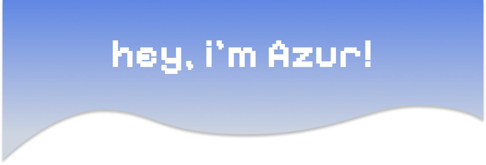
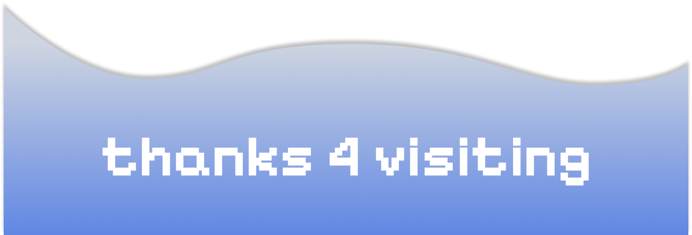

  

<h1 align="center">Azur</h1>

  Systems & Web Engineer · CS student @ Hochschule Bochum

  I build high-performance web apps and system tools. SvelteKit on top, Rust underneath, Linux holding it together.

  Most of my time goes into breaking systems apart to see why they're slow, then putting them back together. But better.

  
  

---

## Stack

### Core & Systems
- **Languages:**  Rust •  TypeScript •  C#
- **OS & Environment:**  Arch Linux •  NixOS *(learning)*
- **Editor:**  Neovim

### Web Engineering
- **Frameworks:**  SvelteKit •  React
- **Styling:**  Tailwind CSS
- **Runtime:**  Bun •  Node.js

### Backend & Infrastructure
- **Stack:**  .NET 10 •  Docker
- **Server:** Caddy • Cloudflare
- **Databases:**  PostgreSQL

### Design
- **Tools:**  Figma

## Currently

- Working the seam between bare-metal systems (Rust, Linux) and lightweight UI (SvelteKit), chasing down where the friction is.
- Rebuilding my own infra from scratch on NixOS.
- Reverse-engineering things to see how they actually work: protocols, browser internals, the occasional rabbit hole.

## GitHub

  
  

  

